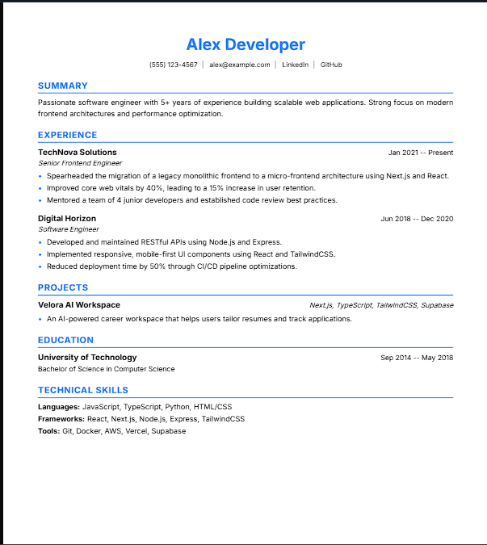
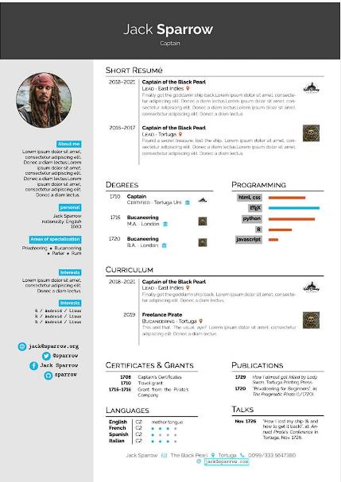
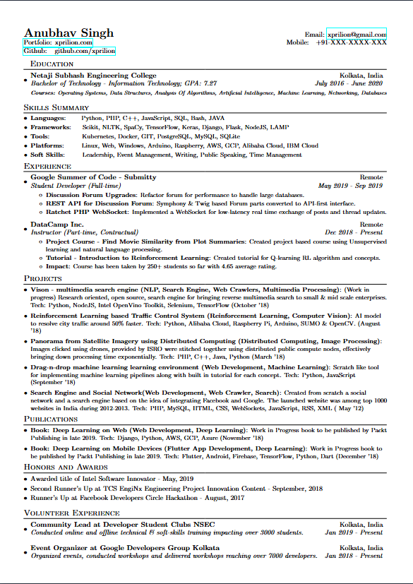
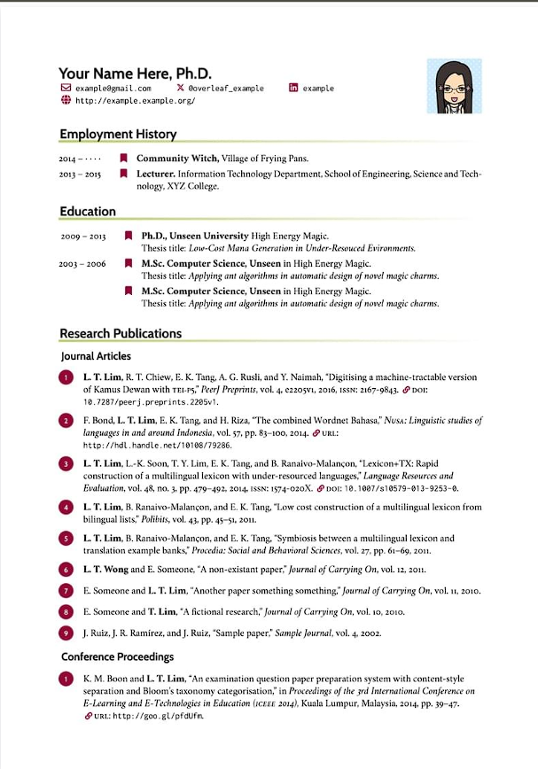
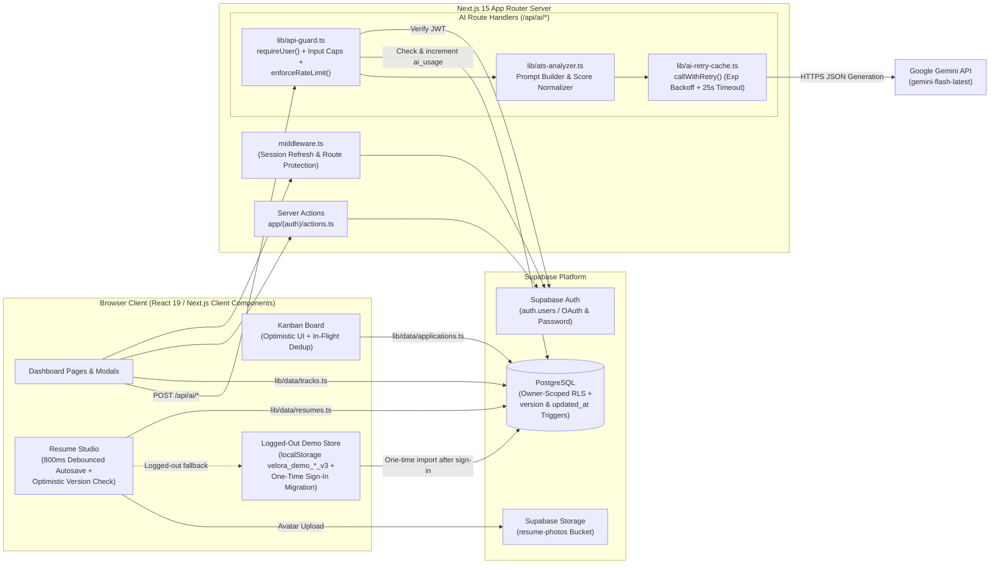
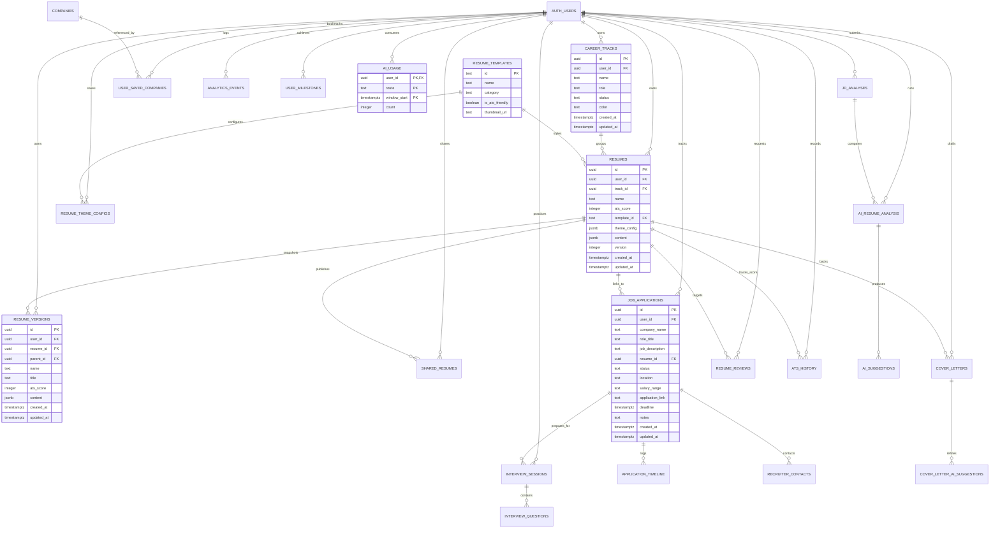
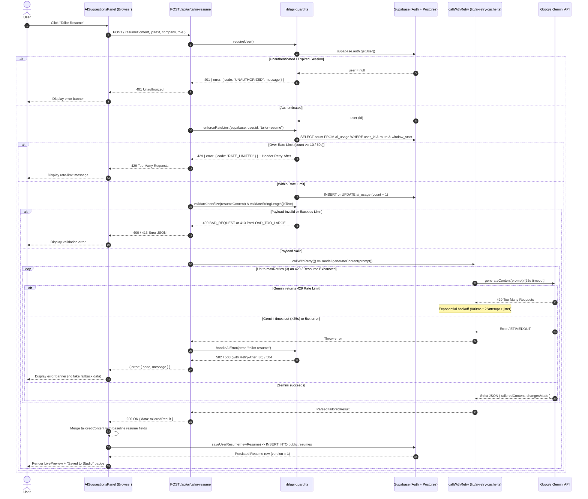

# 🚀 Velora — AI-Powered Career Intelligence & Resume Studio

[](https://github.com/Slash-495/Velora/actions/workflows/ci.yml)

**Velora** is a full-stack AI career workspace built with **Next.js 15**, **Supabase**, and **Google Gemini (`gemini-flash-latest`)**. It combines a live Visual/LaTeX Resume Studio with optimistic concurrency control, ATS resume scoring and job-description tailoring, an idempotent Kanban application tracker, an AI mock interview simulator, cover letter generation, and career activity analytics.

🔗 **Live Demo**: [https://velora-ai.vercel.app](https://velora-ai.vercel.app) *(replace with your deployment URL)*

---

## 📸 Screenshots & Demo Preview

| Dashboard & Career Heatmap | Resume Studio (Visual + LaTeX) |
| :---: | :---: |
|  |  |
| *Overview metrics, career tracks, and 18-month activity grid* | *Debounced autosave, live A4 preview, and optimistic conflict detection* |

| AI ATS Tailoring & Optimization | Kanban Application Pipeline |
| :---: | :---: |
|  |  |
| *Keyword gap analysis and one-click JD tailoring via Gemini* | *Idempotent drag-and-drop across Wishlist, Applied, OA, Interview, Final Round, Offer, and Rejected* |

> 💡 *Tip: Drop a screen-recording GIF at `public/demo.gif` and reference `` above.*

---

## 🏗️ System Architecture



---

## 🗄️ Database Schema (`erDiagram`)

All user-owned tables enforce `user_id NOT NULL DEFAULT auth.uid()` with `ON DELETE CASCADE` to `auth.users(id)` and Row-Level Security policies restricting `SELECT`, `INSERT`, `UPDATE`, and `DELETE` to `auth.uid() = user_id`.



---

## 🔄 Sequence Diagram: Tailor Resume to a Job Description

The sequence below shows the end-to-end execution path when a user clicks **Tailor Resume** in [`AISuggestionsPanel.tsx`](components/dashboard/ai-assistant/AISuggestionsPanel.tsx), including authentication, fixed-window rate limiting, input validation, exponential-backoff retries on upstream Gemini `429` errors, error handling, and persistence of the newly tailored resume.



---

## ⚖️ Design Decisions & Trade-offs

1. **Supabase Repository Layer + Explicit Logged-Out Demo Mode (`lib/data/` & `lib/user-data-store.ts`)**
   - **Decision**: All authenticated reads and writes go through typed Supabase repositories ([`lib/data/resumes.ts`](lib/data/resumes.ts), [`lib/data/tracks.ts`](lib/data/tracks.ts), [`lib/data/applications.ts`](lib/data/applications.ts)). `localStorage` (`velora_demo_*_v3`) is strictly isolated to unauthenticated demo sessions, and [`migrateLocalStorageToSupabaseOnce`](lib/data/demo-storage.ts) performs a one-time import of legacy local items upon sign-in, remapping local `track-*` and `res-*` IDs to newly generated database UUIDs.
   - **Trade-off**: Maintaining a dual path in [`lib/user-data-store.ts`](lib/user-data-store.ts) adds a small amount of client-store coordination code, but allows visitors to test the Resume Studio and Kanban board before creating an account without polluting authenticated state.

2. **Optimistic Concurrency Control (`resumes.version`) over Real-Time CRDTs**
   - **Decision**: Resume edits are debounced by 800ms ([`hooks/use-debounce.ts`](hooks/use-debounce.ts)) and persisted via `UPDATE resumes SET ... WHERE id = $1 AND version = $expectedVersion`. A PostgreSQL `BEFORE UPDATE` trigger (`trg_resumes_version_and_updated_at`) automatically increments `version`. If 0 rows match because another tab saved a newer version, [`updateResume`](lib/data/resumes.ts) fetches the latest server row and throws [`VersionConflictError`](lib/data/types.ts), pausing autosave and prompting the user to reload.
   - **Trade-off**: Simpler, stateless, and free of WebSocket connection overhead compared to Yjs/CRDTs, at the cost of whole-document conflict resolution if a single user edits the same resume simultaneously in two browser tabs.

3. **Postgres-Backed Fixed-Window Rate Limiting (`public.ai_usage`) over External Redis**
   - **Decision**: Per-user, per-route rate limiting ([`enforceRateLimit`](lib/api-guard.ts)) is stored in the `public.ai_usage` table keyed by `(user_id, route, window_start)`.
   - **Trade-off**: Avoids introducing a separate Redis/Upstash dependency and keeps all infrastructure inside Supabase, at the cost of 1–2 extra database round-trips per AI API request.

4. **Template Foreign-Key Normalization (`normalizeTemplateForDb`)**
   - **Decision**: The `resume_templates` table seeds three canonical IDs (`velora-professional`, `modern-minimalist`, `dev-terminal`), while the UI also supports `creative-accent`. [`lib/data/resumes.ts`](lib/data/resumes.ts) stores the exact UI template ID in `theme_config.__templateId` and maps unseeded template IDs to a valid FK value on `resumes.template_id`.
   - **Trade-off**: Preserves referential integrity against `resume_templates(id)` without requiring a schema migration every time a purely visual React template is added.

---

## 🔒 Security

- **Row-Level Security (RLS) Everywhere**:
  - Every user-owned table has RLS enabled with explicit owner-scoped policies (`USING (auth.uid() = user_id)` on reads/updates/deletes and `WITH CHECK (auth.uid() = user_id)` on inserts/updates).
  - Child tables without a direct `user_id` column (`ai_suggestions`, `application_timeline`, `recruiter_contacts`, `interview_questions`, `cover_letter_ai_suggestions`) enforce ownership via `EXISTS (...)` subqueries against their parent table's `user_id`.
  - Automated multi-tenant isolation test suite in [`supabase/tests/rls.sql`](supabase/tests/rls.sql) verifies inside a rolled-back transaction that User A cannot read, update, delete, or attach child rows to User B's data.
- **Server-Side Authentication Guard (`requireUser`)**:
  - Every `/api/ai/*` endpoint verifies the caller's session via `supabase.auth.getUser()` before executing any logic. Unauthenticated requests immediately receive `401 UNAUTHORIZED`.
- **Per-User Rate Limiting (`enforceRateLimit`)**:
  - Limits each authenticated user to `10` requests per `60`-second window per AI route (configurable via `RateLimitOptions`). Exceeding the limit returns `429 RATE_LIMITED` with a standard `Retry-After` header.
- **Input Size Caps & Validation**:
  - [`validateStringLength`](lib/api-guard.ts) and [`validateJsonSize`](lib/api-guard.ts) cap short strings at `500` chars, long text (JDs/notes) at `15,000` chars, serialized JSON at `100,000` chars, and base64 uploads at `7,000,000` chars (~5 MB), returning `400` or `413` before hitting Gemini.
- **Resilient Upstream AI Calls (`callWithRetry` & `handleAIError`)**:
  - [`callWithRetry`](lib/ai-retry-cache.ts) enforces a 25-second timeout per Gemini attempt (`504 AI_TIMEOUT`) and retries `429` / quota errors with exponential backoff and jitter, mapping persistent upstream rate limits to `503 UPSTREAM_RATE_LIMITED` (`Retry-After: 30`) and other failures to `502 AI_GENERATION_FAILED`—never returning fabricated success payloads.

---

## ⚠️ Known Limitations & What I'd Change at 100x Scale

### Current Limitations
1. **Non-Atomic Read-Then-Write in Rate Limiter**: [`enforceRateLimit`](lib/api-guard.ts) performs a `SELECT` followed by an `INSERT` or `UPDATE` on `ai_usage`. Concurrent requests from the same user within a few milliseconds can race and slightly exceed the window count.
2. **Synchronous AI Route Execution**: `/api/ai/*` routes await full JSON responses from Gemini before returning, holding serverless function invocations open for 2–15 seconds.
3. **Client-Side PDF Rendering**: PDF export in the Resume Studio and Cover Letters uses `html2pdf.js` (`html2canvas` + `jsPDF`) in the browser, which rasterizes DOM nodes rather than producing selectable vector text or compiling LaTeX server-side.
4. **Secondary Modules Using Static/Mock Data**: Core flows (Resumes, Career Tracks, Job Applications, and all `/api/ai/*` routes) are backed by Supabase, but several secondary views—such as the public share preview ([`app/resume/[shareId]/page.tsx`](app/resume/[shareId]/page.tsx)), the Company Research directory, and dashboard summary widgets ([`components/dashboard/widgets/CareerTracks.tsx`](components/dashboard/widgets/CareerTracks.tsx))—still read from static mock arrays in [`lib/mock-data.ts`](lib/mock-data.ts).

### What Would Change at 100x Scale
1. **Atomic Sliding-Window Rate Limiting**: Replace the `SELECT` + `UPDATE` on `ai_usage` with either a single PostgreSQL RPC (`INSERT INTO ai_usage ... ON CONFLICT (user_id, route, window_start) DO UPDATE SET count = ai_usage.count + 1 RETURNING count`) or an edge Redis/Upstash sliding-window limiter in `middleware.ts`.
2. **Streaming & Background Queue for AI Workloads**: Switch long-running Gemini prompts (resume tailoring, deep resume review, company insights) to streaming responses (`generateContentStream`) or enqueue jobs via a worker queue (e.g., BullMQ / Inngest / Trigger.dev) with Supabase Realtime progress notifications.
3. **Server-Side Vector PDF & TeX Compilation**: Offload PDF generation to an isolated worker running headless Chromium (Playwright) for HTML templates and a sandboxed `tectonic` / `pdflatex` container for the LaTeX editor so exported PDFs contain selectable text for ATS parsers.
4. **Section-Level Diffs & Cursor Pagination**: Split large `resumes.content` JSONB updates into section-level patches and add keyset pagination (`(updated_at, id)`) on `listResumes` and `listApplications`.

---

## 🛠️ Technology Stack

- **Framework**: [Next.js 15](https://nextjs.org/) (App Router, Server Actions, Route Handlers)
- **Language & UI**: [React 19](https://react.dev/), [TypeScript 5](https://www.typescriptlang.org/), [TailwindCSS 3](https://tailwindcss.com/), [Framer Motion 12](https://www.framer.com/motion/), [Lucide React](https://lucide.dev/)
- **Code Editor**: [`@monaco-editor/react`](https://www.npmjs.com/package/@monaco-editor/react) (LaTeX source mode)
- **AI SDK**: [`@google/generative-ai`](https://www.npmjs.com/package/@google/generative-ai) (`gemini-flash-latest`)
- **Database & Auth**: [Supabase](https://supabase.com/) (`@supabase/supabase-js`, `@supabase/ssr`)
- **Testing & CI**: [Vitest](https://vitest.dev/) & GitHub Actions (`.github/workflows/ci.yml`)

---

## 🚀 Getting Started

### Prerequisites
- **Node.js**: v20+ recommended (v18.17.0+)
- **npm**
- A **Supabase** project and a **Google Gemini API key**

### 1. Clone the Repository

```bash
git clone https://github.com/Slash-495/Velora.git
cd Velora
```

### 2. Install Dependencies

```bash
npm install
```

### 3. Configure Environment Variables

Create a `.env.local` file in the project root:

```env
# Supabase Configuration
NEXT_PUBLIC_SUPABASE_URL=https://your-project-ref.supabase.co
NEXT_PUBLIC_SUPABASE_ANON_KEY=your-supabase-anon-key

# Google Gemini AI API Key
GEMINI_API_KEY=your-gemini-api-key

# Site URL (Optional for OAuth callback)
NEXT_PUBLIC_SITE_URL=http://localhost:3000
```

### 4. Apply Database Migrations & Verify RLS

Link the Supabase CLI to your development project and push all migrations in `supabase/migrations/`:

```bash
npx supabase link --project-ref <your-dev-project-ref>
npx supabase db push
```

To run the multi-user RLS verification test script against your development database:

```bash
psql "<your-dev-database-connection-string>" -v ON_ERROR_STOP=1 -f supabase/tests/rls.sql
```

### 5. Run the Development Server

```bash
npm run dev
```

Open [http://localhost:3000](http://localhost:3000) in your browser.

---

## 📜 Available Scripts

- `npm run dev` — Launch the Next.js development server on `http://localhost:3000`.
- `npm run build` — Run production lint, TypeScript checks, and build the Next.js bundle.
- `npm run start` — Start the Next.js production server.
- `npm run lint` — Run ESLint checks.
- `npm run typecheck` — Run TypeScript compiler checks (`tsc --noEmit`).
- `npm test` — Run the Vitest unit test suite (`vitest run`).
- `npm run test:watch` — Run Vitest in interactive watch mode.

---

## 📄 License

This project is open-source and available under the [MIT License](LICENSE).
